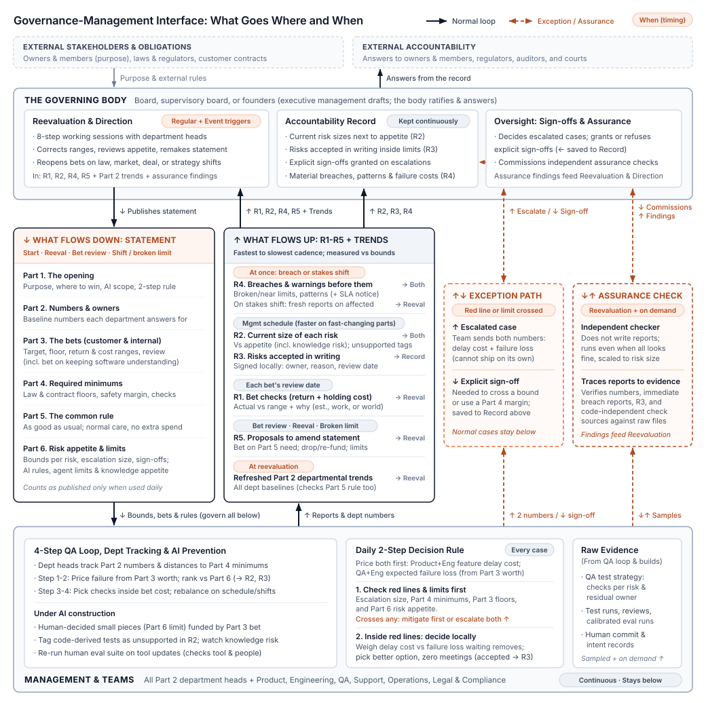

# What each role does and gains

Part of [Governance of quality](quality-governance.md).

Managers spend hours every week in alignment meetings and in defending budgets, and product still pushes for the deadline and cuts quality, sometimes deep enough to damage the whole product. That much effort with that little effect points at a missing tool: a way to state the trade between speed and quality that everyone in the fight can read. The pages before this one describe the tool. This page says what each role does with it and what each gains, because no single role can put it in place alone.

The reason is in who answers for what. Usually the product manager answers for delivery and the QA lead for quality, and each pushes for what they answer for. The QA lead can write a rule, that nothing ships without a regression run, say, and the product manager is free to ignore it, because the QA lead has no authority over product; a rule the product manager writes has the same standing with QA; and when the two agree a rule together, the argument continues over what its words mean, because neither side has a number to settle it with. The product manager is rewarded for shipping on time, the QA lead is blamed for the failures that reach customers, and nobody below the top is judged on the balance between the two. So a rule both have to follow can only come from someone with authority over both, and it needs numbers that no single function sees; [value.md](value.md) says why that place is the top.

## The governing body

The body ratifies and publishes the six-part statement ([value.md](value.md)), settling across silos what no single department below it can decide for the rest: where the company intends to win, which quality bets it commits to and funds from the return and cost forecasts the departments bring, the margins around legal and contractual minimums, the common rule for everything else, and the numerical risk appetite and delegation limits per kind of risk. In a small company the founders write the statement directly with the leads; in a larger company executive management drafts and calibrates it with the department heads for the governing body to decide and ratify ([definitions.md](definitions.md)). [value.md](value.md) describes how those sessions arrive at the numbers, [interface.md](interface.md) what comes back up, and [implementations.md](implementations.md) the testing work operational management runs in between, which the body does not have to learn.

Between reevaluations, the regular moments when it refreshes the baseline numbers, re-asks what each level is worth and how much risk it accepts, and remakes the statement, the body holds the department heads to account for the numbers they own: it asks questions, judges the answers and applies consequences (ISO 37000 6.5.3.3). It stops deciding the daily cases that fit inside the statement's bounds ([interface.md](interface.md)), and it stops taking the compliance function's files for its governance ([definitions.md](definitions.md)).

What a board usually receives about quality today, when it receives anything, is a certificate: a SOC 2 report, an ISO/IEC 27001 certificate, a passed audit. A certificate tells outsiders that a process met a standard's criteria over a period. It does not say whether the checkout path held four nines (99.99% availability), what missing them cost, or whether the risk sizes management reported were right. Assurance is the body's own check on exactly those things, run by someone who does not write the reports ([interface.md](interface.md) describes the check). The body decides how much scrutiny each risk gets by the size of the risk, and it gives the checker the authority, the resources and the independence to do it (ISO 37000 6.4.3.3). A company can hold every certificate on the market and have no assurance about its quality levels.

Nobody outside the company will demand any of this of the body. Cyber security got its board-level interface when regulation put it there: under rules adopted in 2023, public companies in the United States describe in their annual reports how the board oversees the risks from cybersecurity threats, and what management's role and expertise in managing them are ([SEC, Regulation S-K, Item 106](quality-governance.md#references)). The default, then, is no interface between the board and a risk-bearing function until someone demands one. Product quality has no regulator, so the demand has to come from the body itself, and the standards put the duty there. The body develops the criteria by which progress towards its purpose is measured, and sets its expectation of the quality and timeliness of measurement (ISO 37000 4.3.2 b and c). Its stated performance expectations are the basis for measurement, its own and management's (38500 7.2.6).

The body also has its own reason to want this. [value.md](value.md) describes good quality as a competitive advantage that comes back as renewals kept, deals won and a price that holds, each in the numbers of one department. Below the top nobody answers for the whole of that return; the body does, so it has the most to gain from stating what quality is worth.

For software built with agents the body has four acts inside the statement, and [erosion.md](erosion.md) describes them:

- in Part 1, it names the practice, how the company's software is built with agents, as something it governs;
- in Part 6, it sets the conditions on the people who use the agent and the delegation limits on what may be handed to the agent in one piece and what people must decide;
- in Part 6, it sets the numerical appetite for the risk of losing the knowledge all of the above runs on: how the software works, and why it is the way it is;
- in Part 3, it places and funds the prevention bet that pays for the people who keep that knowledge, while leaving the choice of workflow to management.

The body gains what the [problem statement](quality-governance.md) promises under Structure: one exposure picture in comparable units, an appetite set deliberately, and the record it answers from. From the four acts it gains what the problem statement promises under Adoption: agents used at a pace the company can sustain, with the knowledge risk watched like any other risk and the people who keep the knowledge paid for like any other bet.

## Every department head

The heads of the departments whose numbers stand in Part 2 of the statement, the list of the numbers each department tracks and answers for, are customer success, sales, support, engineering, product and marketing, and finance and legal. In the working sessions that draft and refresh the statement, each head owns and answers for that department's numbers. In a small company those same leads may also sit directly in the four-step loop of [Economics of Testing](../testing_economics/testing_economics.md); in a larger company the operational managers inside product, engineering, QA, support and operations run that loop inside the bounds the statement sets, ranking the risks and sorting them against Part 6's bounds into the risks that must be reduced, the risks management accepts in writing within its authority, and the risks small enough to live with ([implementations.md](implementations.md), step 2).

Each head has three duties in the statement, and the earlier pages describe them:

- stating the department's numbers as they stand today, in its own units (and refreshing them at each reevaluation), together with what holding each candidate level would win or protect, as a range ([value.md](value.md), steps 2 and 6 of its eight-step method);
- answering for that range as a bet: at the review date the head puts what actually happened next to it and says why when it missed ([interface.md](interface.md), the first of the five kinds of reports that flow up);
- proposing an amendment to the statement when a number the department owns gets worse over a need without a bet, when a bet's stakes disappear, or when an existing bet's budget or bound no longer fits ([value.md](value.md), [interface.md](interface.md)).

A head may state a worth only in numbers the department owns. Customer success can say three to five renewals a year kept from leaving over reliability, tracked through churn reasons and renewal objections ([value.md](value.md), step 6); sales can say two to four stalled deals unblocked in vendor review. Neither can say "reputation", because nobody can put an observable record next to that word, so the bet could never be checked.

When the body hands a department a level to hold or a number to answer for, its head is entitled to the conditions of the delegation before accepting it. ISO 37000 lists five: the expected outcomes agreed, the resources available, authority matching responsibility, periodic reporting with evidence, and enforceable consequences (4.2.2). A head of support asked to hold a response time without the people to hold it can point at that clause, and so can an engineering manager asked to keep a level whose estimated cost the body never funded.

The department heads gain what the problem statement promises under Information, a case stated in money instead of a plea: the departments' numbers reach the top together ([value.md](value.md)), so the head of support no longer has to convince the head of product that this quarter's complaint counts mean something; the top sees them next to everyone else's numbers.

## Product leadership

Under the two-step decision rule on [interface.md](interface.md), product with engineering estimates what waiting to test more on this particular feature would cost the company (the feature's delay plus the extra checking), and QA with engineering estimates from the statement what shipping now risks. "It's urgent" carries no number, so today the argument is won by authority ([implementations.md](implementations.md)); the estimate carries one. Suppose a customer's March renewal depends on the feature: if the team postpones it past March, the company may lose the renewal, so product can state the delay cost. Suppose instead it is a redesign of the account-settings screen that no renewal and no trial depends on: the delay cost is almost nothing. An expensive deadline still cannot cross a red line in Part 3, Part 4 or Part 6 on its own; when the risk fits inside all the red lines, the team compares what waiting costs against the expected failure loss that waiting would remove and decides locally.

For software built with agents, when management meets the body's Part 3 knowledge-preservation bet through a workflow such as the building sessions [implementations.md](implementations.md) describes as a candidate countermeasure, product leadership supplies the person who knows what the feature is for and can settle trade-offs in the session itself, and supplies the expected business-rule results for the suite of checks over the agent; the body funds those hours through the bet, so they do not come out of the roadmap unpaid. The business rules that person states go into the written intent records, saying why the feature exists and what it must do, and product answers for that record being where the team can find it.

Product gains what the problem statement promises under Decision: inside the red lines, the case for shipping now is decided from its numbers, locally and without escalation, and a case that crosses a limit goes up with both numbers attached, so product can see what would change the answer. The bets in Part 3 of the statement state quality's worth in numbers product also wants to grow, so product and QA argue from the same statement.

## Engineering leadership

Engineering's numbers in Part 2, outages, rework, regressions and how long changes take, are its evidence when product asks for corners to be cut, and its cost ranges for holding each level go into the bets ([value.md](value.md)). When the company builds its software with agents, engineering backs and answers for the Part 3 bet on keeping the team's understanding of the software (checked against those Part 2 numbers and the knowledge indicators), and carries the technical work behind the body's acts on [erosion.md](erosion.md):

- it proposes the delegation limit for Part 6 on what may be handed to the agent in one piece ([interface.md](interface.md), report 5), because only engineering can say what size of step its people can still judge;
- it builds and keeps an assurance mechanism over the changing tool, such as the suite of calibrated checks [erosion.md](erosion.md) describes, fixed instructions with expected results written by people and run whenever the tool changes, with product and QA supplying the expected results for the rules they own;
- it reports the indicators [erosion.md](erosion.md) lists for the knowledge risk, as the current size of that risk next to the appetite the body set for it in Part 6.

In any step-by-step workflow such as a building session, the engineers have to be able to judge each step the agent proposes. Where that skill has already gone, engineering leadership says so and asks through the Part 3 bet for the time and training money to rebuild it before relying on human supervision. The standard for the governance of IT asks the body for assurance that its intentions are carried out by people with the competence to do so, and that the organization has the skills to implement change ([erosion.md](erosion.md) carries the clauses); engineering is the department that tells it when either has stopped being true.

Engineering gains two things. Today, when product asks for a corner to be cut, the engineering manager can only say that something feels wrong, and the corner is cut; under the statement the manager points at rework rising every quarter since the last shortcut, a number engineering answers for, and the argument is about that number. When the company builds with agents, the hours engineers spend on deliberate supervision, training and keeping the suite of checks are funded through the body's Part 3 bet, so the engineering manager no longer takes them out of the delivery schedule unpaid.

## QA leadership

The QA lead's ask of the top is concrete, a published six-part statement coming down and the five kinds of reports going back up ([interface.md](interface.md) lists both), and the standard backs it. People with the relevant IT expertise belong in the decisions tied to their responsibilities (38500 5.6.2). Material breaches reach the body promptly (5.5.3). IT risks are handled through an explicit risk process (5.10.2), re-evaluated continuously as conditions shift (6.2.2), and tracked with fitting measures (6.2.4). Where the law is silent or unsettled, the body states its own compliance expectations (5.5.2), and on product quality levels no law speaks at all. And wherever needs have been found, the body directs management to bring forward proposals (6.2.3). The QA lead can point at each of those clauses.

The ask is for a seat in the decisions and for the duty of supplying the evidence; QA does not take governance over, and [definitions.md](definitions.md) says why.

Under the statement the QA lead convenes the four-step loop and picks the checks; [implementations.md](implementations.md) follows it step by step, and the strategy record, QA's written account of what covers each risk, stays below with management for the assurance check.

What the QA lead supplies is assurance evidence, and the difference from a certificate matters here too. "All tests pass" and a coverage percentage say that the testing process ran; they are certificates of the tests. The assurance check asks what the checks would have caught, what evidence they produced and who accepted what remains, and only the strategy record answers that. A QA lead who reports pass rates upward hands the body a certificate when the body needs assurance.

When the company builds with agents, the QA lead adds one thing to that record and to the risk report ([interface.md](interface.md), report 2): for each risk size, whether the evidence behind it comes from somewhere other than the code. A risk covered only by tests the agent generated from its own code is marked and reported upward as unsupported, and the assurance check verifies that tagging.

When management runs a workflow such as building sessions, QA's prevention hours (sitting in prioritized sessions and supplying expected results for the suite of checks) are funded through the body's Part 3 bet alongside product's and engineering's; while tester headcount is scarce, say one tester to five developers ([proposal](../ai-era-testing/proposal.md)), QA leadership rations where a tester sits by the risk register: in the sessions on the refund flow [implementations.md](implementations.md) follows, where money leaves the company, and not in those on the account-settings screen.

QA gains the upward case: the vocabulary, the clause references and the money, so the QA lead stops arguing from feelings. "This is risky" becomes "this risk is currently estimated at this size, against this appetite, with this evidence behind it". The standard says the seat should exist, so the QA lead asks for what the standard already expects of the body.

## Questions anyone can ask in their own company

Where the answer is "nobody" or "nowhere", the page in brackets is where this research answers it.

1. Who can say what a day's outage on the paying customers' path would cost the company, and which department owns that number? ([value.md](value.md))
2. Is there a written appetite per kind of risk, with the size of decision above which management escalates, or does each budget fight set its own? ([value.md](value.md), Part 6 of the statement)
3. When product says "it's urgent" and QA says "it's risky", what settles it: published red lines first and two numbers inside them, or whoever has more authority? ([interface.md](interface.md))
4. For each risk on the risk register, can the QA lead show which checks cover it and who accepted what remains, and does anyone above ever ask to see it? ([implementations.md](implementations.md), [interface.md](interface.md))
5. When did the company last lower a quality level on purpose, with an owner, a reason and a review date? ([value.md](value.md))
6. Take one business rule in the code. Can someone say why it is there, and is the reason written anywhere the team can find? ([erosion.md](erosion.md))
7. Does the board know how the company's software is built with agents, what may be handed over in one piece and whether people decide the steps, or only that agents are used? ([implementations.md](implementations.md), [erosion.md](erosion.md))
